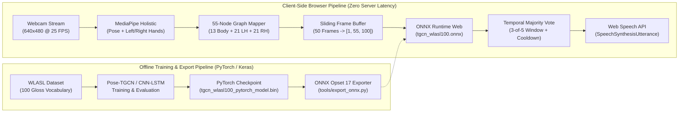

# Handy-Talk — Real-Time Sign-Language-to-Speech Recognition

**Handy-Talk** is a real-time American Sign Language (ASL) word-level recognition and speech synthesis system. It combines **MediaPipe Holistic** 3D skeletal/hand keypoint extraction, a **Pose-based Temporal Graph Convolutional Network (Pose-TGCN)** trained on the **WLASL-100** dataset, **ONNX Runtime Web (WebAssembly)** for zero-server in-browser inference, and the **Web Speech API** for instant voice synthesis.

> **Live Interactive Demo:** Try Handy-Talk directly in your browser on the [Portfolio Live Demo](https://portfolio-ebon-xi-52.vercel.app) (under **Featured Projects → Handy-Talk → Try Live Demo**).

---

## System Architecture



---

## Key Features

- **Privacy-First In-Browser Inference:** Video frames never leave the user's device. Keypoint extraction and neural network inference execute locally via WebAssembly (`onnxruntime-web` and `@mediapipe/tasks-vision`).
- **55-Node Upper-Body & Dual-Hand Skeletal Graph:** Extracts 13 upper-body landmarks (nose, neck, shoulders, elbows, wrists, mid-hip, eyes, ears) and 42 hand landmarks (21 left hand + 21 right hand) normalized to $[-1, 1]$ in the original OpenPose layout expected by Pose-TGCN.
- **Multi-Stage Attention Pose-TGCN (`GCN_muti_att`):** Models spatial intra-frame joint dependencies via a learnable $55 \times 55$ graph attention adjacency matrix and temporal trajectories across 50 frames ($T = 50$, 100 features per node) across 20 residual Graph Convolution blocks (`GC_Block`).
- **Temporal Majority-Vote Smoothing:** Filters out transient gesture noise by requiring at least 3 out of the last 5 sliding-window predictions to agree above a confidence threshold (`0.38`) before locking in a word and triggering speech output.
- **Built-In Text-to-Speech (TTS):** Automatically speaks recognized signs aloud using the browser's `window.speechSynthesis` engine with configurable mute/unmute controls and a real-time sentence transcript builder.
- **Background Asset Preloader:** Warms up the MediaPipe Holistic Vision WASM binaries, `holistic_landmarker.task` model, and `tgcn_wlasl100.onnx` checkpoint in the background during idle time.

---

## Technical Pipeline

### 1. 55-Keypoint Spatial Graph Construction

For each video frame sampled at $25\text{ FPS}$ ($40\text{ ms}$ interval), MediaPipe `HolisticLandmarker` detects 33 pose landmarks and 21 landmarks per hand. Handy-Talk maps these into the 55-node OpenPose topology:

| Node Indices | Anatomical Region | Source Landmarks |
| :--- | :--- | :--- |
| `0 – 12` (13 nodes) | Upper Body | Nose (`pose[0]`), Neck (`midpoint(pose[11], pose[12])`), Right/Left Shoulders, Elbows, Wrists, Mid-Hip (`midpoint(pose[23], pose[24])`), Eyes, Ears |
| `13 – 33` (21 nodes) | Left Hand | `leftHandLandmarks[0..20]` (Wrist to all 5 fingertips) |
| `34 – 54` (21 nodes) | Right Hand | `rightHandLandmarks[0..20]` (Wrist to all 5 fingertips) |

Each 2D coordinate $(x, y) \in [0, 1]^2$ is affine-normalized to $[-1, 1]^2$:

$$x_{\mathrm{norm}} = 2x - 1, \qquad y_{\mathrm{norm}} = 2y - 1$$

Missing or occluded landmarks default to $(-1, -1)$ so the graph structure remains fixed at $N = 55$ nodes.

### 2. Sliding-Window Tensor Layout (`[1, 55, 100]`)

A FIFO ring buffer (`TgcnFrameBuffer`) accumulates $T = 50$ consecutive frames ($2.0\text{ seconds}$ at $25\text{ FPS}$). For each node $v \in \{0, \dots, 54\}$, the $x$ and $y$ coordinates across all 50 frames are interleaved into a 100-dimensional temporal feature vector:

$$\mathbf{X}_{1, v, 2t} = x_{t, v}, \qquad \mathbf{X}_{1, v, 2t+1} = y_{t, v} \qquad \forall t \in \{0, \dots, 49\}$$

This yields a contiguous `Float32Array(5500)` tensor of shape `[1, 55, 100]`.

### 3. Pose-TGCN Architecture

Defined in [`tgcn_wlasl100_web/pytorch/tgcn_model.py`](tgcn_wlasl100_web/pytorch/tgcn_model.py), the network processes the `[batch, 55, 100]` input tensor through:

1. **Input Graph Convolution (`GraphConvolution_att`):** Projects input features from $100 \to 64$ channels using a learnable feature weight matrix $\mathbf{W} \in \mathbb{R}^{100 \times 64}$ and a learnable spatial attention adjacency matrix $\mathbf{A} \in \mathbb{R}^{55 \times 55}$:
   $$\mathbf{H} = \tanh\left(\mathrm{BN}\left(\mathbf{A}\mathbf{X}\mathbf{W} + \mathbf{b}\right)\right)$$
2. **20 Residual Graph-Convolutional Stages (`num_stage = 20`):** Each `GC_Block` applies two stacked `GraphConvolution_att(64, 64)` layers with 1D Batch Normalization, $\tanh$ activation, dropout ($p = 0.3$), and a residual skip connection ($\mathbf{Y} = \mathcal{F}(\mathbf{H}) + \mathbf{H}$).
3. **Global Node Pooling & Classifier:** Averages hidden representations across all 55 nodes and projects to 100 WLASL gloss logits (`fc_out: 64 -> 100`), followed by a numerically stable softmax layer.

---

## Repository Structure

```text
Handy-Talk/
├── web/                                      # React / TypeScript Browser Client Components
│   ├── HandKeypointDemo.tsx                  # Full webcam UI, Holistic tracker, ONNX runner & Web Speech TTS
│   └── ModelPreloader.tsx                    # Background preloader for MediaPipe WASM & ONNX models
├── tgcn_wlasl100_web/                        # Pose-TGCN WLASL-100 ONNX Package & JS Adapters
│   ├── model/
│   │   ├── tgcn_wlasl100.onnx                # Exported ONNX model (opset 17, input [B, 55, 100] -> logits [B, 100])
│   │   ├── labels.json                       # Ordered array of 100 WLASL English sign glosses
│   │   └── label_map.json                    # Index-to-gloss mapping dictionary
│   ├── pytorch/
│   │   ├── tgcn_model.py                     # PyTorch Pose-TGCN architecture (GCN_muti_att, GC_Block)
│   │   ├── tgcn_wlasl100_pytorch_model.bin   # Pretrained WLASL-100 PyTorch state_dict checkpoint
│   │   └── config.ini                        # Hyperparameter configuration (50 frames, 64 hidden, 20 stages)
│   ├── tools/
│   │   └── export_onnx.py                    # Reproducible PyTorch -> ONNX exporter script
│   ├── web/
│   │   ├── tgcn-input.js                     # MediaPipe Holistic -> [1, 55, 100] Float32Array converter
│   │   └── tgcn-inference.js                 # ONNX Runtime Web session wrapper & Top-K softmax ranker
│   ├── LICENSES.md                           # Upstream model & dataset license notices (MIT / C-UDA)
│   └── SHA256SUMS                            # Checksums for model weight verification
├── real-time demo/                           # Standalone Python OpenCV webcam recognition demo
│   ├── demo.py
│   └── model/WLASL20c_model.h5
├── web app/                                  # Flask client-server prototype
│   ├── server.py
│   ├── static/
│   └── templates/
├── tools/                                    # WLASL dataset splitting, video padding & search utilities
├── train_model.py                            # Keras CNN-LSTM sequence model training script
├── evaluate_model.py                         # Test-set evaluation script
├── models.py                                 # Model definitions for WLASL subsets (20c, 100, 300, 1000, 2000)
├── frame_generator.py                        # Custom video frame sequence generator
├── data_utils.py                             # Label encoding & dataset helpers
└── requirements.txt                          # Python dependencies
```

---

## Quick Start

### 1. Using the Browser Inference Engine (`tgcn_wlasl100_web`)

Install the lightweight runtime dependencies in your web project (`Next.js`, `Vite`, or `React`):

```bash
npm install onnxruntime-web @mediapipe/tasks-vision
```

Copy `tgcn_wlasl100_web/model/tgcn_wlasl100.onnx` and `tgcn_wlasl100_web/model/labels.json` into your static `public/models/` directory, then initialize the recognizer:

```javascript
import { TgcnFrameBuffer } from "./tgcn_wlasl100_web/web/tgcn-input.js";
import { createTgcnRecognizer } from "./tgcn_wlasl100_web/web/tgcn-inference.js";

const buffer = new TgcnFrameBuffer();
const recognizer = await createTgcnRecognizer({
  modelUrl: "/models/tgcn_wlasl100.onnx",
  labelsUrl: "/models/labels.json",
  executionProviders: ["wasm"],
});

// Inside your 25 FPS MediaPipe Holistic frame loop:
const holisticResult = holisticLandmarker.detectForVideo(videoElement, performance.now());

if (buffer.pushHolisticResult(holisticResult)) {
  const inputTensor = buffer.toFloat32Array(); // Float32Array(5500) -> [1, 55, 100]
  const topPredictions = await recognizer.predict(inputTensor, 5);
  console.log("Top prediction:", topPredictions[0]);
}
```

Or drop the full React component [`web/HandKeypointDemo.tsx`](web/HandKeypointDemo.tsx) directly into a Next.js + Tailwind CSS application.

---

### 2. Re-Exporting the PyTorch Checkpoint to ONNX

To verify or customize the ONNX graph from the PyTorch state dictionary:

```bash
python3 -m venv .venv
source .venv/bin/activate
pip install torch onnx

python3 tgcn_wlasl100_web/tools/export_onnx.py \
  --checkpoint tgcn_wlasl100_web/pytorch/tgcn_wlasl100_pytorch_model.bin \
  --architecture tgcn_wlasl100_web/pytorch/tgcn_model.py \
  --output tgcn_wlasl100_web/model/tgcn_wlasl100.onnx
```

Verify file integrity against `SHA256SUMS`:

```bash
cd tgcn_wlasl100_web && shasum -a 256 -c SHA256SUMS
```

---

### 3. Running the Python Training & OpenCV Demo Pipeline

```bash
python3 -m venv .venv
source .venv/bin/activate
pip install -r requirements.txt

# Train sequence model on preprocessed WLASL splits
python train_model.py

# Evaluate trained checkpoint on the test split
python evaluate_model.py

# Run standalone OpenCV webcam demo
python "real-time demo/demo.py"
```

---

## Supported Vocabulary (WLASL-100)

The Pose-TGCN model recognizes 100 common ASL words from the WLASL-100 benchmark, including:

> `accident`, `africa`, `all`, `apple`, `basketball`, `bed`, `before`, `bird`, `birthday`, `black`, `blue`, `book`, `bowling`, `brown`, `but`, `can`, `candy`, `chair`, `change`, `cheat`, `city`, `clothes`, `color`, `computer`, `cook`, `cool`, `corn`, `cousin`, `cow`, `dance`, `dark`, `deaf`, `decide`, `doctor`, `dog`, `drink`, `eat`, `enjoy`, `family`, `fine`, `finish`, `fish`, `forget`, `full`, `give`, `go`, `graduate`, `hat`, `hearing`, `help`, `hot`, `how`, `jacket`, `kiss`, `language`, `last`, `later`, `letter`, `like`, `man`, `many`, `medicine`, `meet`, `mother`, `need`, `no`, `now`, `orange`, `paint`, `paper`, `pink`, `pizza`, `play`, `pull`, `purple`, `right`, `same`, `school`, `secretary`, `shirt`, `short`, `fine`, `son`, `study`, `table`, `tall`, `tell`, `thanksgiving`, `thin`, `thursday`, `time`, `walk`, `want`, `what`, `white`, `who`, `woman`, `work`, `wrong`, `year`, `yes`

*(See [`tgcn_wlasl100_web/model/labels.json`](tgcn_wlasl100_web/model/labels.json) for the exact class index ordering.)*

---

## License & Attribution

- Source code and web adapters in this repository are released under the [MIT License](LICENSE).
- The WLASL dataset and pretrained weights follow the [Computational Use of Data Agreement (C-UDA)](tgcn_wlasl100_web/LICENSES.md) for academic and non-commercial research use.
